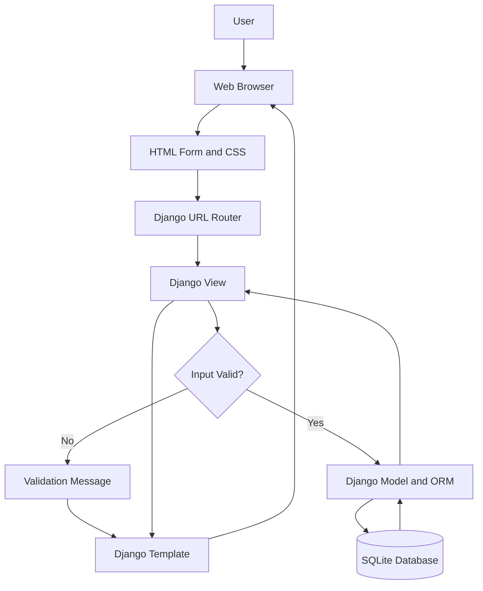
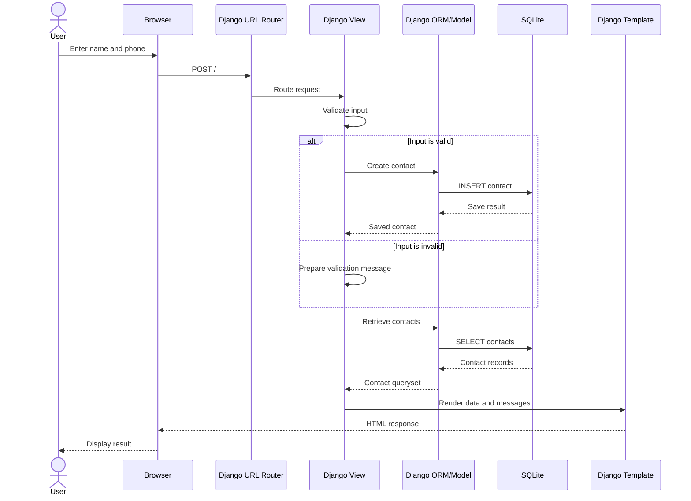
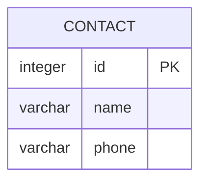

# Software Architecture Design (SAD)
## Contact Book App

- **Document Version:** 1.0
- **Status:** Initial Baseline
- **Project Type:** Beginner-Level Web Application
- **Backend:** Python Django
- **Frontend:** HTML5, CSS3, Django Templates
- **Database:** SQLite
- **Architecture Style:** Django MVT (Model–View–Template)

---

## 1. Introduction

### 1.1 Purpose

This Software Architecture Design (SAD) document describes the high-level architecture, components, responsibilities, data flow, database design, and project structure of the Contact Book App.

The application is a beginner-level web project demonstrating how an HTML/CSS frontend communicates with a Django backend and how Django stores and retrieves contact records using SQLite.

### 1.2 Scope

The initial version allows a user to:
- Open the Contact Book webpage.
- Enter a contact's name and phone number.
- Submit contact information through a form.
- Save valid contact information to an SQLite database.
- View previously saved contacts on the webpage.
- Receive success or validation messages.

Contact editing, deletion, search, authentication, multiple-user support, and external integrations are outside the scope of this version.

### 1.3 Architectural Goals

The architecture should:
- Be easy for a beginner to understand and maintain.
- Separate presentation, application logic, and data storage.
- Use Django's built-in ORM for database operations.
- Validate required input before saving.
- Preserve records across page refreshes and server restarts.
- Use Django's CSRF protection for POST form submissions.
- Support future enhancements without requiring a complete redesign.

---

## 2. Architecture Overview

The application uses Django's Model–View–Template (MVT) pattern.

- **Model:** Defines contact data and interacts with the database through Django ORM.
- **View:** Handles requests, validates submitted data, performs application logic, and selects the response.
- **Template:** Renders the HTML page and displays the contact form, saved contacts, and feedback messages.
- **URL Configuration:** Maps browser URLs to the appropriate Django view.
- **SQLite:** Stores contact records persistently.

### 2.1 High-Level Architecture Diagram



### 2.2 Architecture Style

The system follows a simple, server-rendered web architecture using Django MVT. The browser submits a form to Django, Django processes the request and interacts with SQLite, and a Django template returns the resulting HTML page.

The initial version does not require a separate REST API, frontend JavaScript framework, or external database server.

---

## 3. System Components

### 3.1 Presentation Layer

**Technologies:** HTML5, CSS3, Django Templates

**Responsibilities:**
- Display the Contact Book page.
- Provide name and phone number input fields.
- Display the Save Contact button.
- Show success and validation messages.
- Render saved contact names and phone numbers.
- Provide a simple, clean, responsive layout.

**Suggested template:** `contacts/templates/contacts/index.html`

### 3.2 Routing Layer

**Technology:** Django URL dispatcher

**Responsibilities:**
- Receive requests for application URLs.
- Map the home page URL to the contacts view.
- Keep URL definitions separate from view logic.

**Suggested files:**
- `config/urls.py` — project-level URL configuration.
- `contacts/urls.py` — app-level URL configuration.

**Suggested routes:**

| URL | Method | Purpose |
|---|---|---|
| `/` | GET | Display the form and saved contacts |
| `/` | POST | Validate and save a submitted contact |

The same home page route may handle both GET and POST requests in the initial version.

### 3.3 Application Logic Layer

**Technology:** Python and Django views

**Responsibilities:**
- Process incoming GET and POST requests.
- Read the submitted name and phone number.
- Validate that required fields are not empty.
- Save valid contact information using the model.
- Retrieve saved contacts for display.
- Provide success or validation feedback.
- Handle expected database or application errors appropriately.

**Suggested file:** `contacts/views.py`

### 3.4 Data Access Layer

**Technology:** Django ORM

**Responsibilities:**
- Represent contact records using a Django model.
- Create and retrieve model records as required.
- Translate model operations into database queries.
- Avoid manually building SQL queries for normal contact operations.

**Suggested file:** `contacts/models.py`

### 3.5 Database Layer

**Technology:** SQLite

**Responsibilities:**
- Persist contact records.
- Maintain the primary key for each contact.
- Store names and phone numbers.
- Make saved records available after a browser refresh or local server restart.

**Database file:** `db.sqlite3`

**Expected table name:** `contacts_contact`, when the Django app is named `contacts` and the default table naming convention is used.

---

## 4. Component Interaction

### 4.1 Displaying the Contact Book Page

1. The user opens the application in a web browser.
2. The browser sends a GET request to `/`.
3. Django's URL dispatcher routes the request to the contacts view.
4. The view retrieves existing contacts through the Django ORM.
5. Django passes the contact records to the template.
6. The template renders the form and contact list.
7. The browser displays the generated HTML page.

### 4.2 Saving a Contact

1. The user enters a name and phone number.
2. The user submits the form using the Save Contact button.
3. The browser sends a POST request to Django.
4. Django verifies CSRF protection and processes the request.
5. The view checks that the required fields are not empty.
6. If the input is valid, the view creates and saves a contact through the Django ORM.
7. The view prepares a success message and retrieves the current contact list.
8. Django renders the page with the updated list and feedback message.
9. The browser displays the result.

If validation fails, the application should show a useful message and avoid saving an invalid record.

### 4.3 Data Flow Diagram



---

## 5. Database Architecture

### 5.1 Database Overview

The application uses SQLite, a file-based relational database supported by Django by default. It is suitable for this small local learning project and does not require a separate database server.

- **Database file:** `db.sqlite3`
- **Django app:** `contacts`
- **Default table name:** `contacts_contact`

### 5.2 Contact Entity

The initial version contains one entity: `Contact`.

| Field | Suggested Django Field | Constraints / Purpose |
|---|---|---|
| `id` | Default model primary key | Primary key, generated automatically |
| `name` | `CharField(max_length=100)` | Required contact name |
| `phone` | `CharField(max_length=20)` | Required phone number |

Phone numbers are stored as character data rather than numeric data because they may contain leading zeros, a plus sign, spaces, or other formatting characters.

### 5.3 Entity Relationship Diagram



There are no relationships to other tables in this initial version.

### 5.4 Data Integrity

- Each contact has a unique automatically generated primary key.
- Name and phone number are required by the application.
- Input should be validated before saving.
- Database migrations should be used to create and update the schema.
- Phone numbers should not be treated as values for arithmetic calculations.

---

## 6. Application Structure

Suggested project structure:

```text
ContactBook/
│
├── manage.py
├── db.sqlite3
├── requirements.txt
│
├── config/
│   ├── __init__.py
│   ├── settings.py
│   ├── urls.py
│   ├── asgi.py
│   └── wsgi.py
│
└── contacts/
    ├── __init__.py
    ├── admin.py
    ├── apps.py
    ├── models.py
    ├── views.py
    ├── urls.py
    ├── tests.py
    ├── migrations/
    │   └── __init__.py
    ├── templates/
    │   └── contacts/
    │       └── index.html
    └── static/
        └── contacts/
            └── style.css
```

### 6.1 File Responsibilities

| File / Folder | Responsibility |
|---|---|
| `manage.py` | Runs Django management commands |
| `config/settings.py` | Application settings, installed apps, templates, and database configuration |
| `config/urls.py` | Main URL routing |
| `contacts/models.py` | Defines the Contact model |
| `contacts/views.py` | Handles requests, validation, saving, and retrieval |
| `contacts/urls.py` | Maps app URLs to views |
| `contacts/templates/contacts/index.html` | Displays the form, messages, and contact list |
| `contacts/static/contacts/style.css` | Contains page styling |
| `contacts/tests.py` | Contains automated tests |
| `contacts/migrations/` | Stores database schema migration files |
| `db.sqlite3` | Stores local database records |
| `requirements.txt` | Lists Python dependencies |

The exact structure may vary slightly depending on how the Django project is created.

---

## 7. Security Design

### 7.1 CSRF Protection

- Include Django's `` template tag inside the POST form.
- Keep Django's CSRF middleware enabled.
- Submit the form using POST when creating a contact.

### 7.2 Input Validation

- Reject a submission if the name or phone number is blank.
- Apply reasonable maximum lengths to model fields.
- Display clear validation messages.
- Do not trust browser-side validation alone; validate submitted data on the server.

### 7.3 Database Access

- Use Django ORM methods for normal database operations.
- Avoid constructing SQL statements by concatenating user input.
- Handle expected database errors without exposing sensitive technical details to the user.

### 7.4 Output Rendering

- Render contact values through Django templates using normal auto-escaping behavior.
- Do not mark untrusted user input as safe HTML.

### 7.5 Development Settings

For local development, use Django's development server. Before public deployment, configure secure production settings, including `DEBUG = False`, a suitable `ALLOWED_HOSTS` value, secret management, and HTTPS.

---

## 8. Error Handling and Feedback

| Situation | Expected Behavior |
|---|---|
| Name is empty | Show a validation message; do not save |
| Phone number is empty | Show a validation message; do not save |
| Contact saved successfully | Show a success message and updated list |
| Database operation fails | Handle the error and show a general error message |
| No contacts exist | Display “No contacts saved yet.” or similar |
| Unsupported HTTP method | Return an appropriate HTTP response, as configured |

Error messages should be understandable and should not expose database credentials, secret values, or unnecessary internal details.

---

## 9. Non-Functional Architecture Considerations

### 9.1 Maintainability

Keep models, views, URLs, templates, and styles in their appropriate files. Avoid putting all application logic into the HTML template.

### 9.2 Performance

For the expected small contact list, a simple ORM query is sufficient. Pagination or advanced query optimization is not required for the initial version.

### 9.3 Reliability

Use Django migrations to manage schema changes and preserve saved records in the SQLite database file.

### 9.4 Usability

Use clearly labelled fields, a visible Save Contact button, readable messages, and a responsive page layout.

### 9.5 Compatibility

The application should work in modern desktop browsers when run in a supported local Python/Django environment.

---

## 10. Testing Strategy

| Test ID | Test | Expected Result |
|---|---|---|
| SAD-T01 | Open the home page | Form and saved contacts are displayed |
| SAD-T02 | Submit an empty name | Validation message is displayed |
| SAD-T03 | Submit an empty phone number | Validation message is displayed |
| SAD-T04 | Submit valid contact data | Contact is stored in SQLite |
| SAD-T05 | View saved contacts | Contact name and phone are displayed |
| SAD-T06 | Refresh the page | Previously saved contacts remain available |
| SAD-T07 | Restart the development server | Previously saved contacts remain available |
| SAD-T08 | Submit a valid POST form with CSRF token | Request succeeds |
| SAD-T09 | Verify the database record | Record is present in the expected table |

Automated tests can be written in `contacts/tests.py` using Django's testing framework.

---

## 11. Deployment and Execution

The initial release is intended for local development.

Typical setup commands, from the project directory, are:

```bash
python -m venv .venv
```

Activate the virtual environment on Windows:

```bat
.venv\Scripts\activate
```

Install Django:

```bash
python -m pip install django
```

Create database tables:

```bash
python manage.py makemigrations
python manage.py migrate
```

Start the local development server:

```bash
python manage.py runserver
```

Open the local address shown in the terminal, typically `http://127.0.0.1:8000/`.

If the project and app have already been created, do not repeat the project-creation commands. Add the `contacts` app to `INSTALLED_APPS` in `config/settings.py` and include its URL configuration in `config/urls.py`.

---

## 12. Assumptions and Constraints

### 12.1 Assumptions

- The application is used locally by a general user.
- The initial interface is server-rendered using Django templates.
- The user enters a name and phone number manually.
- The database is SQLite.
- Only basic contact creation and listing are required.

### 12.2 Constraints

- No user authentication is included.
- No contact edit or delete functionality is included.
- No REST API or separate frontend framework is included.
- No cloud deployment or external database service is required.
- The project is intended as a beginner-level learning application.

---

## 13. Future Enhancements

Possible improvements for later versions include:

- Edit and delete contacts.
- Search and filter contacts.
- Add user registration and login.
- Add form-level phone number validation.
- Add pagination for large contact lists.
- Create a REST API if a separate frontend is introduced.
- Deploy the application to a production hosting platform.
- Add automated test coverage and a backup strategy.

These features are not part of the initial baseline.

---

## 14. Conclusion

The Contact Book App uses a straightforward Django MVT architecture. HTML and CSS provide the user interface, Django URLs and views process requests, the Contact model and Django ORM handle data access, and SQLite stores contact records.

This separation keeps the application understandable and maintainable while demonstrating the complete data flow:

**Browser → Django URL → Django View → Django Model/ORM → SQLite → Django Template → Browser**

The design is suitable for a beginner-level project and provides a foundation for future contact-management features.
